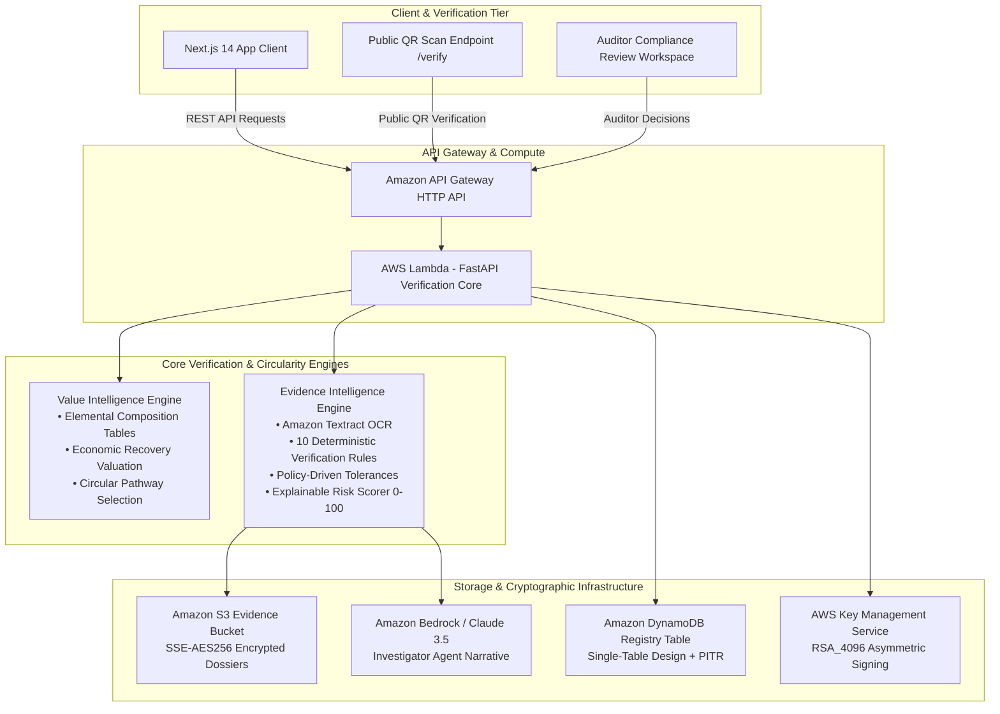
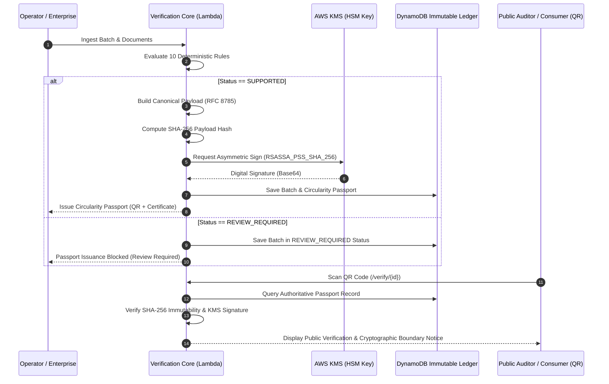

# Waste2Value — Technical Architecture & Security Specification

**Tagline:** Turn Waste Into Verified Value.  
**Platform Classification:** AI-Powered Circularity Intelligence & E-Waste Verification SaaS  
**Cloud Architecture:** AWS Serverless • FastAPI REST Core • Next.js 14 Web Client • AWS KMS HSM Signing

---

## 1. System Architecture Overview

Waste2Value is architected as two cooperating intelligent engines feeding into a cryptographically secured Digital Product Passport ledger:

---

## 2. Dual Engine Specification

### 2.1 Engine 1: Value Intelligence Engine
- **Elemental Fraction Models:** Pre-configured elemental recovery yields based on Basel Convention and WEEE Directive composition studies:
  - *IT & Telecom:* High precious metal concentrations (Gold, Silver, Palladium, High-grade Copper).
  - *Consumer Electronics:* Mixed base metals, engineered polymers, secondary copper.
  - *Large Appliances:* High structural steel (60%+), cast iron, aluminum alloys.
  - *Lithium Batteries:* Cobalt, Lithium Carbonate, Nickel, Graphite.
- **Economic Valuation Model:**
  $$\text{Net Recovered Value} = \sum (\text{Yield Mass}_i \times \text{Spot Price}_i) - \text{Refining \& Thermal Processing Costs}$$
- **Circular Pathway Hierarchy:**
  `REUSE` $\rightarrow$ `REFURBISHMENT` $\rightarrow$ `COMPONENT_RECOVERY` $\rightarrow$ `MATERIAL_RECOVERY` $\rightarrow$ `RECYCLING`

### 2.2 Engine 2: Evidence Intelligence Engine
- **Deterministic Verification Rules (Pure Python Core):**
  - **Rule 1 (Unit Normalization):** Converts all declared quantities to canonical kilograms ($kg$).
  - **Rule 2–5 (Mass Balance Reconciliation):** Compares transport waybills, weighbridge tickets, and certified outputs against material-specific policy tolerances.
  - **Rule 6 (Timeline Plausibility):** Detects negative elapsed time ($\text{Collection Date} > \text{Processing Date}$) indicating fraudulent ticket reuse.
  - **Rule 7 (Recycler Consistency):** Verifies facility operator license registration strings against accredited registries.
  - **Rule 8 (Duplicate Evidence Collision):** Flags serial numbers (`WB-2024-9901`) matching archived records in the immutable registry.
  - **Rule 9 (Evidence Completeness):** Verifies required document dossier based on stream category (e.g., Batteries mandate Recycling Certificate in addition to weighbridge records).
  - **Rule 10 (Explainable Risk Scoring):** Formulates transparent 0–100 risk scorecard with 4 distinct penalty dimensions.

---

## 3. Cryptographic Verification & Trust Architecture

---

## 4. DynamoDB Single-Table Schema Design

| Partition Key (`PK`) | Sort Key (`SK`) | `GSI1PK` | `GSI1SK` | Entity Type | Data Attributes |
| :--- | :--- | :--- | :--- | :--- | :--- |
| `BATCH#{batch_id}` | `METADATA` | `STATUS#{status}` | `DATE#{created_at}` | Batch Consignment | `batch_number`, `category`, `claimed_kg`, `mass_balance`, `risk_score` |
| `BATCH#{batch_id}` | `DOC#{doc_id}` | `TYPE#{doc_type}` | `TIMESTAMP` | Evidence Document | `file_name`, `extracted_fields`, `bounding_boxes` |
| `BATCH#{batch_id}` | `FINDING#{id}` | `SEVERITY#{sev}` | `RULE#{rule_id}` | Verification Finding | `rule_id`, `severity`, `title`, `observed_value` |
| `PASSPORT#{p_id}` | `METADATA` | `HASH#{sha256}` | `ISSUE_DATE` | Circularity Passport | `sha256_hash`, `kms_signature`, `revoked` |

---

## 5. Security Threat Model & Safeguards

1. **Tampering with Issued Passports:**
   - *Safeguard:* RFC 8785 Canonical Serialization ensures consistent key order. Changing 1 character breaks the SHA-256 hash. The public verification page includes a live tampering simulator demonstrating instant detection.
2. **Forged Digital Signatures:**
   - *Safeguard:* Asymmetric private signing keys are sealed inside AWS KMS Hardware Security Modules (FIPS 140-3 Level 3). Lambda possesses `kms:Sign` permissions, but cannot export the private key.
3. **Deceptive Silent Demo Fallbacks:**
   - *Safeguard:* In Live Mode, network or cloud errors trigger explicit error alerts. Silent demo fallback is strictly prohibited to prevent confusing cloud outages with verified recycling outcomes.
4. **Physical Reality Disclaimer:**
   - *Safeguard:* Every issued passport and public verification screen features an explicit cryptographic boundary notice: *Cryptographic verification establishes data integrity relative to the authoritative ledger; it does not replace independent on-site physical facility audits.*
